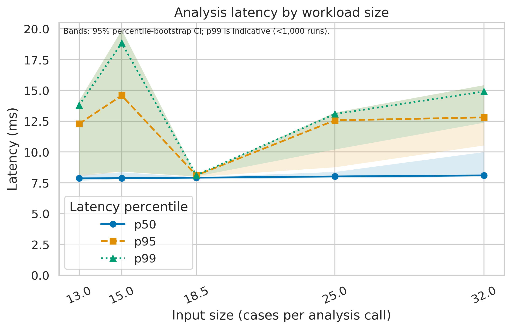
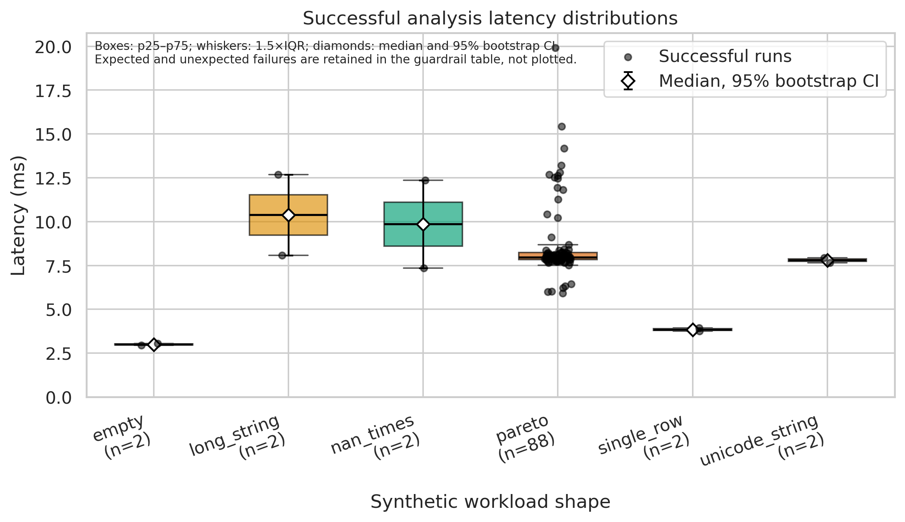

# AI-Enabled Incident Triage and IT Service Management (ITSM)

**Authors:** Aimara Temresheva, Kirill Dolgopolov  
**Course:** Research Methods (SCOM3001), Tasks 2–3  
**License:** MIT

## Research question

How are AI-enabled incident triage mechanisms integrated into ITSM workflows (RQ1), how do they change operational handoff velocity and resolution pathways (RQ2), and how are human escalation protocols structured relative to algorithmic autonomy (RQ3) in Kazakhstani fintech environments?

## Overview

This mixed-methods (qualitative-driven) study codes public engineering disclosures, post-mortems, and regulatory documents using the Document Analysis Protocol in [`docs/codebook.md`](docs/codebook.md). The research pipeline computes HITL, handoff-time, misrouting, and governance measures, tests H1.1–H1.3, and evaluates the registered study guardrails.

> **Evidence warning:** `data/sample/` and `data/raw/test_run.jsonl` are synthetic demonstration data. They validate the pipeline but are not observations about real companies and must not be interpreted as research findings. Replace them only with collected, de-identified study data before making empirical claims.

## Task 3 results & discussion

The LMS-ready Markdown section is [`reports/paper_section_4.md`](reports/paper_section_4.md).

### C1 baseline vs E1 proposed method (synthetic sample)

The table below is a reproducibility example calculated from the 12 synthetic cases in `data/sample/cases.csv`; each cell is the median (p25–p75). C1 is the legacy baseline and E1 is the guardrailed hybrid method. The paired handoff reduction is unavailable for C1 because the legacy sample has no paired time observations.

| Metric | Baseline: C1 (n=4) | Proposed: E1 (n=4) |
|---|---:|---:|
| HITL embedding score (1–5) | 1.50 (1.00–2.00) | 4.00 (4.00–4.25) |
| Handoff reduction (%) | Not available | 53.59 (51.64–54.81) |
| Misrouting rate (%) | 15.83 (14.89–17.00) | 5.78 (5.48–6.17) |
| Governance index (0–3) | 1.50 (0.75–2.00) | 3.00 (2.75–3.00) |

These illustrative differences are not evidence: the sample is synthetic, has only four cases per group, and cannot support conclusions about the research hypotheses.

### Local analysis-pipeline profile (synthetic inputs)

The checked-in JSONL profiles one synchronous `analyze()` call over 100 evaluation runs on synthetic workloads. The current example has 98 successful runs and 2 expected invalid-input failures (2% total evaluation error rate; 0% unexpected errors). Successful-run latency is 7.95 ms median (p25–p75: 7.79–8.22 ms), p95 12.69 ms, and p99 15.57 ms. These are local code-profile values, not ITSM service performance; p99 is indicative with this sample size. Environment details and every run are in [`data/raw/test_run.jsonl`](data/raw/test_run.jsonl), and the aggregate table is [`data/processed/metrics_summary.csv`](data/processed/metrics_summary.csv).



**Figure 1.** Latency percentiles by input size in cases per analysis call. Shaded bands are 95% percentile-bootstrap confidence intervals. The benchmark does not control offered request rate, so the x-axis is not RPS.



**Figure 2.** Successful-run latency by synthetic workload shape. Boxes show p25–p75, whiskers 1.5×IQR, and diamonds show the median with a 95% bootstrap confidence interval. Failed runs are retained in the guardrail summary.

Vector exports: [Figure 1 PDF](reports/figures/fig1_latency_vs_load.pdf) · [Figure 2 PDF](reports/figures/fig2_distribution_boxplot.pdf)

### Interpretation and limitations

The timing experiment measures the local Python data-analysis function, not a deployed ITSM system. It has no controlled request-rate schedule, concurrency, network latency, or second runtime implementation. Consequently it cannot substantiate a baseline-versus-proposed **latency** claim; the C1/E1 table above is a synthetic research-metric example only. A production comparison requires representative de-identified data, controlled load, a measured baseline implementation, and a predeclared experimental protocol.

### Domain model (ML/AI track)

The formal domain artifact for the ML/AI track (loss function, target metrics, guardrail definitions, and a notation table, in LaTeX) is in [`docs/domain_model.md`](docs/domain_model.md).

## Reproducible pipeline

Use Python 3.11 or 3.12 with the pinned dependencies (Python 3.13+ is not supported by the pinned numpy 1.26.4), then run from the repository root:

```bash
python -m pip install -r requirements.txt
python run_pipeline.py --config configs/config.yaml
```

The command runs the configured benchmark, writes `data/raw/test_run.jsonl`, excludes warm-up records during processing while retaining failures, creates:

- `data/processed/metrics_summary.csv`
- `data/processed/benchmark_guardrails.csv`
- `reports/figures/fig1_latency_vs_load.pdf` and `.png` (300 DPI)
- `reports/figures/fig2_distribution_boxplot.pdf` and `.png` (300 DPI)

To reprocess the existing raw log without measuring again:
> Re-running without `--skip-benchmark` measures latency again and overwrites `data/raw/test_run.jsonl`; absolute latency values depend on the machine, so the numbers in this README correspond to the committed log.

```bash
python run_pipeline.py --config configs/config.yaml --skip-benchmark
```

The notebook [`notebooks/01_data_analysis.ipynb`](notebooks/01_data_analysis.ipynb) contains the same steps and saved outputs. From the repository root, select the Python 3.11/3.12 environment and use **Kernel → Restart & Run All**.

The Docker image runs the same pipeline:

```bash
docker build -t itsm-bench .
docker run --rm -v "$(pwd)/data:/app/data" -v "$(pwd)/reports:/app/reports" -v "$(pwd)/results:/app/results" itsm-bench
```
In GitHub Codespaces or other remote Docker environments, bind mounts may not work. Copy the outputs out of the container instead:

```bash
docker build -t itsm-bench .
docker run --name bench itsm-bench
docker cp bench:/app/data/. ./data/ && docker cp bench:/app/reports/. ./reports/ && docker rm bench
```

## Repository structure

```text
.
├── README.md
├── LICENSE
├── Dockerfile
├── requirements.txt                    # exact version pins
├── run_pipeline.py                     # entry point: benchmark -> processing -> figures
├── .gitignore                          # excludes checkpoints, caches, virtual environments
├── .dockerignore
├── configs/config.yaml
├── data/
│   ├── raw/test_run.jsonl
│   ├── processed/metrics_summary.csv
│   └── sample/                         # synthetic cases and coder agreement
├── docs/
│   ├── codebook.md
│   ├── methodology_card.md
│   └── domain_model.md                 # ML/AI track: loss, metrics, notation (LaTeX)
├── notebooks/01_data_analysis.ipynb
├── reports/
│   ├── paper_section_4.md              # LMS-ready results section
│   └── figures/                        # PDF and 300-DPI PNG exports
├── src/
│   ├── benchmark.py                    # data-analysis benchmark and Task 2 pipeline
│   ├── metrics.py                      # research outcome formulas
│   ├── process_data.py                 # JSONL validation and aggregation
│   └── visualize.py                    # publication-ready figures
└── tests/test_pipeline.py
```

## Planned research benchmarks

| ID | Hypothesis | Variable(s) | Method | Status |
|---|---|---|---|---|
| B1 | H1.1 | DV1 HITL score, ML vs legacy | Mann–Whitney U (one-sided) | Pipeline ready; real data required |
| B2 | H1.2 (primary) | DV2 handoff-time reduction | Wilcoxon signed-rank (paired) | Pipeline ready; real data required |
| B3 | H1.2 (secondary) | DV3 misrouting rate | Mann–Whitney U (one-sided) | Pipeline ready; real data required |
| B4 | H1.3 | IV2 autonomy vs DV4 governance | Spearman rho (one-sided) | Pipeline ready; real data required |
| G1–G4 | Study guardrails | Misrouting, coder agreement, source share, autonomy/governance | Pre-registered threshold checks | Pipeline ready; real data required |

## Citation

```bibtex
@misc{temresheva2026itsm,
  title  = {AI-Enabled Incident Triage and IT Service Management (ITSM)},
  author = {Temresheva Aimara and Dolgopolov Kirill},
  year   = {2026},
  howpublished = {\url{https://github.com/AimaraGit/itsm-ai-triage-research}}
}
```

Released under the MIT License (see [`LICENSE`](LICENSE)).
