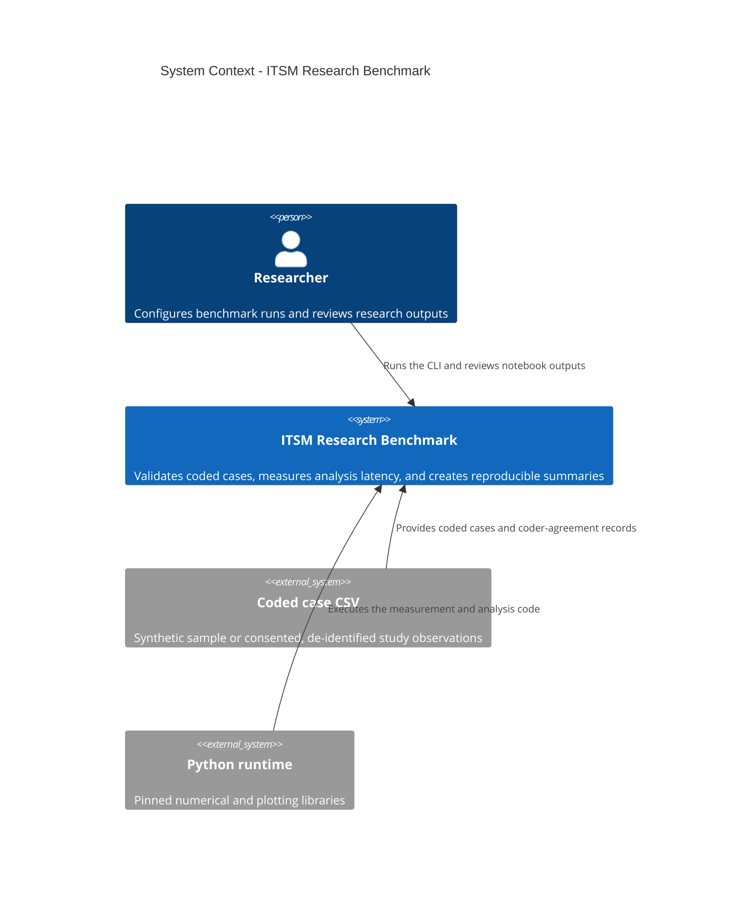
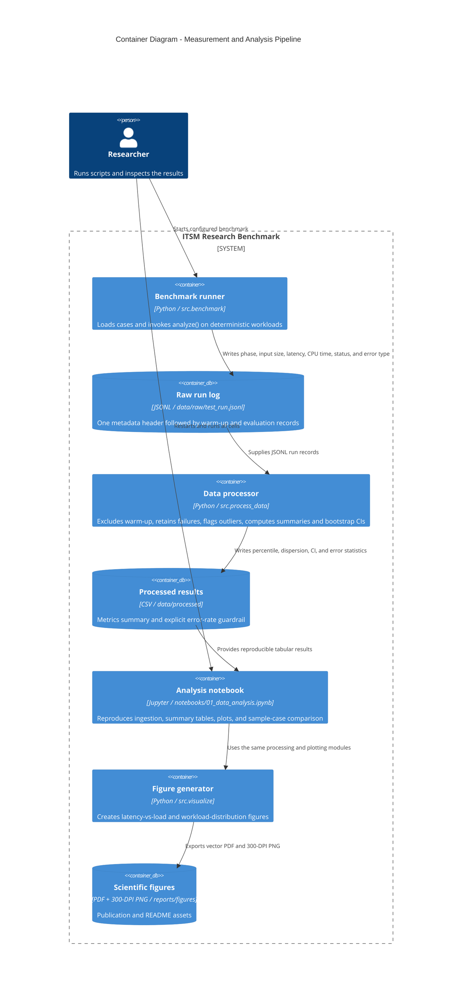

# Domain model: ITSM research benchmark

**Track: Machine Learning / AI.** The primary artifact is the formal LaTeX definition of the loss function, the target metrics and the notation table (Part 1). Part 2 keeps the C4 model of the measurement pipeline, with its metric collection point and measurement definitions, as supporting material. The checked-in sample cases and benchmark logs are synthetic and are not empirical evidence.

## Part 1. ML/AI formalization of the studied AI-triage classifier

**Track: Machine Learning / AI.** This section formalizes the kind of AI triage system that the study examines (a text classifier that routes incident tickets to queues, optionally deferring uncertain tickets to a human). The repository does **not** train this model; it measures the processing pipeline and the coded research indicators defined below. The C4 diagrams in Part 2 are supporting material.

### 1. Problem formulation

A ticket is a text $x \in \mathcal{X}$ and its correct destination queue is $y \in \{1,\dots,K\}$. The labelled data set is $\mathcal{D}=\{(x_i,y_i)\}_{i=1}^{N}$. A feature map $\phi:\mathcal{X}\to\mathbb{R}^{d}$ (for example TF-IDF) turns text into a vector, and the classifier outputs a probability distribution over queues:

$$
p_\theta(k \mid x) = \operatorname{softmax}\big(W\,\phi(x) + b\big)_k,
\qquad \theta = \{W, b\},\ W\in\mathbb{R}^{K\times d},\ b\in\mathbb{R}^{K}
$$

### 2. Loss function

Training minimizes a class-weighted cross-entropy with L2 regularization:

$$
\mathcal{L}(\theta)
= \underbrace{-\frac{1}{N}\sum_{i=1}^{N} w_{y_i}\,\log p_\theta(y_i \mid x_i)}_{\text{weighted cross-entropy}}
\;+\; \underbrace{\lambda\,\lVert \theta \rVert_2^{2}}_{\text{regularization}},
\qquad
w_k = \frac{N}{K\,N_k}
$$

Cross-entropy is used because the target is a class label; MSE treats label indices as numbers and gives an arbitrary notion of "distance" between queues. The weights $w_k$ compensate for rare queues. For severe imbalance the focal variant can replace the first term:

$$
\mathcal{L}_{\text{focal}}(\theta) = -\frac{1}{N}\sum_{i=1}^{N}\big(1-p_\theta(y_i \mid x_i)\big)^{\gamma}\,\log p_\theta(y_i \mid x_i)
$$

### 3. Human-in-the-loop deferral

The system routes a ticket automatically only when it is confident; otherwise a human decides:

$$
\hat{y}(x)=
\begin{cases}
\arg\max_{k}\, p_\theta(k \mid x), & \max_{k}\, p_\theta(k \mid x) \ge \tau,\\[2pt]
\text{defer to a human}, & \text{otherwise.}
\end{cases}
$$

Two quantities describe the trade-off controlled by the threshold $\tau$:

$$
c(\tau) = \Pr\!\big[\max_k p_\theta(k \mid x) \ge \tau\big],
\qquad
R(\tau) = \Pr\!\big[\hat{y}(x)\ne y \;\big|\; \text{not deferred}\big]
$$

Here $c(\tau)$ is the share of automatically routed tickets (coverage) and $R(\tau)$ is the misrouting risk among them; in the study $R(\tau)$ corresponds to the misrouting rate $R_{bounce}$.

### 4. Constrained optimization

The operating objective is to fit the model and choose $\tau$ under the study's guardrails (misrouting at most 15 %, see guardrail G1 in the methodology card), a minimum automation share and a latency budget:

$$
\min_{\theta,\ \tau}\ \mathcal{L}(\theta)
\quad\text{s.t.}\quad
R(\tau) \le 0.15,\qquad c(\tau) \ge c_{\min},\qquad P_{95}(L) \le L_{\max}
$$

With Lagrange multipliers $\mu_1,\mu_2,\mu_3 \ge 0$ the constrained problem is relaxed to

$$
\mathcal{J}(\theta,\tau,\mu)=\mathcal{L}(\theta)+\mu_1\big(R(\tau)-0.15\big)+\mu_2\big(c_{\min}-c(\tau)\big)+\mu_3\big(P_{95}(L)-L_{\max}\big)
$$

### 5. Target metrics

| Metric | Definition | Unit |
|---|---|---|
| Macro-F1 | $\frac{1}{K}\sum_{k=1}^{K}\frac{2\,\mathrm{Prec}_k\,\mathrm{Rec}_k}{\mathrm{Prec}_k+\mathrm{Rec}_k}$ | 0-1 |
| Misrouting rate | $R_{bounce}=100\,\frac{N^{mis}}{N^{tot}}$ | % |
| Handoff-time reduction (primary) | $\Delta T=100\,\frac{T_{legacy}-T_{AI}}{T_{legacy}}$ | % |
| Latency percentile | $P_q=\operatorname{quantile}(L_1,\dots,L_m;\ q/100)$, $q\in\{50,95,99\}$ | ms |
| Speedup | $S=\tilde{L}_{baseline}/\tilde{L}_{proposed}$ | ratio |
| 95 % bootstrap CI | $\big[\hat\theta^{*}_{(0.025)},\ \hat\theta^{*}_{(0.975)}\big]$ over $B=2000$ resamples | same as metric |
| Evaluation error rate | $E=100\,\#\{i: s_i=\text{error}\}/\#\{\text{evaluation runs}\}$ | % |

### 6. Notation table

| Symbol | Type | Meaning | Unit / range |
|---|---|---|---|
| $N$ | scalar | number of labelled tickets | tickets |
| $K$ | scalar | number of destination queues | queues |
| $N_k$ | scalar | tickets of class $k$ in the data set | tickets |
| $d$ | scalar | feature dimension | - |
| $i$ | scalar index | ticket or evaluation-run index | $1,\dots,N$ |
| $k$ | scalar index | queue (class) index | $1,\dots,K$ |
| $\lambda$ | scalar | L2 regularization strength | $\ge 0$ |
| $\gamma$ | scalar | focal-loss focusing parameter | $\ge 0$ |
| $\tau$ | scalar | confidence threshold for automatic routing | $[0,1]$ |
| $c_{\min}$ | scalar | minimum share of automatically routed tickets | $[0,1]$ |
| $L_{\max}$ | scalar | latency budget | ms |
| $w_k$ | scalar | class weight of queue $k$ | $>0$ |
| $x$ | vector in $\mathcal{X}$ | ticket text | - |
| $\phi(x)$ | vector in $\mathbb{R}^{d}$ | feature vector of a ticket | - |
| $b$ | vector in $\mathbb{R}^{K}$ | bias | - |
| $W$ | matrix in $\mathbb{R}^{K\times d}$ | weight matrix | - |
| $\theta$ | parameter set | $\{W, b\}$ | - |
| $\mu_1,\mu_2,\mu_3$ | scalars | Lagrange multipliers | $\ge 0$ |
| $\mathcal{X}$ | set | space of ticket texts | - |
| $\{1,\dots,K\}$ | set | set of queue labels | - |
| $\mathcal{D}$ | set | labelled data set | - |
| $p_\theta(k \mid x)$ | function | predicted probability of queue $k$ | $[0,1]$ |
| $\hat{y}(x)$ | function | routing decision (queue or defer) | - |
| $c(\tau),\ R(\tau)$ | functions | coverage and misrouting risk at threshold $\tau$ | $[0,1]$ |
| $\mathcal{L},\ \mathcal{L}_{\text{focal}},\ \mathcal{J}$ | functions | loss, focal loss, Lagrangian | - |
| $L_i$ | scalar | latency of evaluation run $i$ | ms |
| $\tilde{L}$ | scalar | median latency | ms |
| $P_q$ | scalar | $q$-th latency percentile | ms |
| $T_{legacy},\ T_{AI}$ | scalars | handoff time before / after AI adoption | min |
| $N^{mis},\ N^{tot}$ | scalars | misrouted and total tickets | tickets |
| $B$ | scalar | number of bootstrap resamples | 2000 |
| $s_i$ | label | outcome of run $i$ (success or error) | - |

### 7. Link to the repository

| Quantity | Where it is computed |
|---|---|
| $L_i$, $s_i$, $P_q$, bootstrap CI, $E$ | `src/benchmark.py` (timing), `src/process_data.py` (aggregation) |
| $R_{bounce}$, $\Delta T$, $I_{gov}$, weighted kappa | `src/metrics.py`, `src/benchmark.py` (research indicators) |
| Speedup $S$ | not computed yet: it needs a measured baseline implementation |

## Part 2. Supporting material: C4 model of the measurement pipeline

### C4 system context

### C4 container and metric collection points

**Metric collection point.** `src.benchmark._run_once` reads `time.perf_counter_ns()`
immediately before and after the `analyze()` call. No JSONL writing or plotting occurs
inside that timed region. The record also includes `time.process_time_ns()`, input
case count, workload kind, phase, success/error status, and whether an error was
expected for the invalid-input test case.

### Formal measurement definitions

For evaluation run $i$, let $t_i^{start}$ and $t_i^{end}$ be the monotonic
clock values bracketing the analysis call, $n_i$ the number of input cases, and
$s_i$ its outcome.

$$
L_i = \frac{t_i^{end} - t_i^{start}}{10^6}\;\text{ms},
\qquad
Q_i = \frac{n_i}{L_i / 1000}\;\text{cases/s}
$$

For successful evaluation latencies $L_1,\ldots,L_m$, the reported percentiles
are $P_q = \operatorname{quantile}(L_1,\ldots,L_m,q/100)$, for
$q \in \{25,50,75,95,99\}$. The median's 95% confidence interval is the 2.5th
and 97.5th percentiles of seeded bootstrap resamples of the run-level observations.
Outliers are *flagged*, not removed, using values outside
$[Q_1 - 1.5\,IQR,\;Q_3 + 1.5\,IQR]$ within workload-size bins.

The total evaluation error rate includes every failed run:

$$
E = 100\,\frac{\#\{i:s_i=\mathrm{error}\}}{\#\{\mathrm{evaluation\ runs}\}}\%.
$$

The separate unexpected-error guardrail excludes only explicitly marked invalid-input
test cases; those expected failures remain visible in the summary and raw log.

| Symbol | Definition | Unit |
|---|---|---|
| $i$ | Evaluation-run index | dimensionless |
| $t_i^{start}, t_i^{end}$ | Monotonic timestamps surrounding `analyze()` | ns |
| $n_i$ | Number of coded cases processed in run $i$ | cases |
| $L_i$ | Wall-clock analysis latency | ms |
| $Q_i$ | Derived processing throughput, $n_i/(L_i/1000)$ | cases/s |
| $P_q$ | Empirical $q$-th latency percentile | ms |
| $IQR$ | $P_{75} - P_{25}$ | ms |
| $E$ | Evaluation error rate | % |
| $B$ | Number of bootstrap resamples; fixed at 2,000 by default | resamples |

### Scope and limitations

- The benchmark measures one synchronous Python analysis call at varying **input
  sizes**, not an ITSM service under a controlled request rate. It does not record
  offered requests per second, concurrency, network latency, or live-system
  throughput. The latency figure therefore uses cases per analysis call instead
  of labeling input size as RPS.
- `p99` is indicative with the current 100 evaluation runs; the raw log and notebook
  report the sample size so this estimate is not overstated.
- The raw benchmark uses synthetic case data and deliberately includes error-path
  tests. Its local runtime values are a reproducibility example, not a comparison of
  a legacy runtime against a proposed runtime and not a production performance claim.
- A production comparison requires controlled baseline/proposed implementations,
  representative de-identified inputs, a predeclared request-rate schedule, and
  substantially more repetitions.
