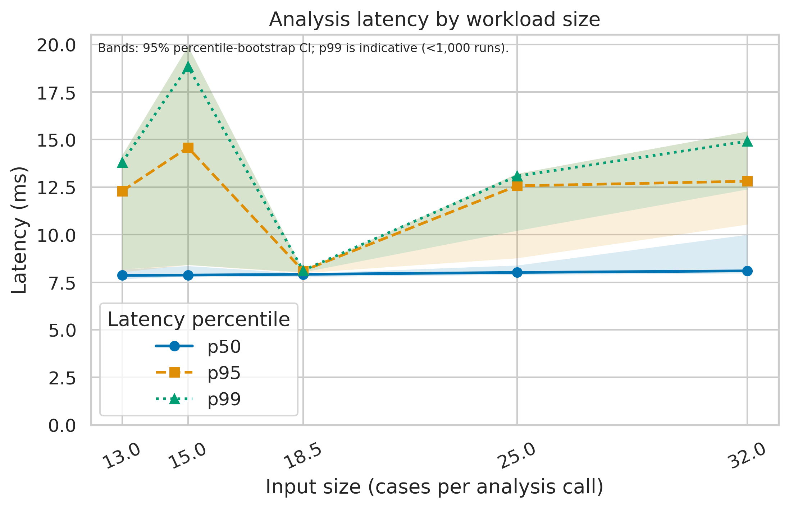
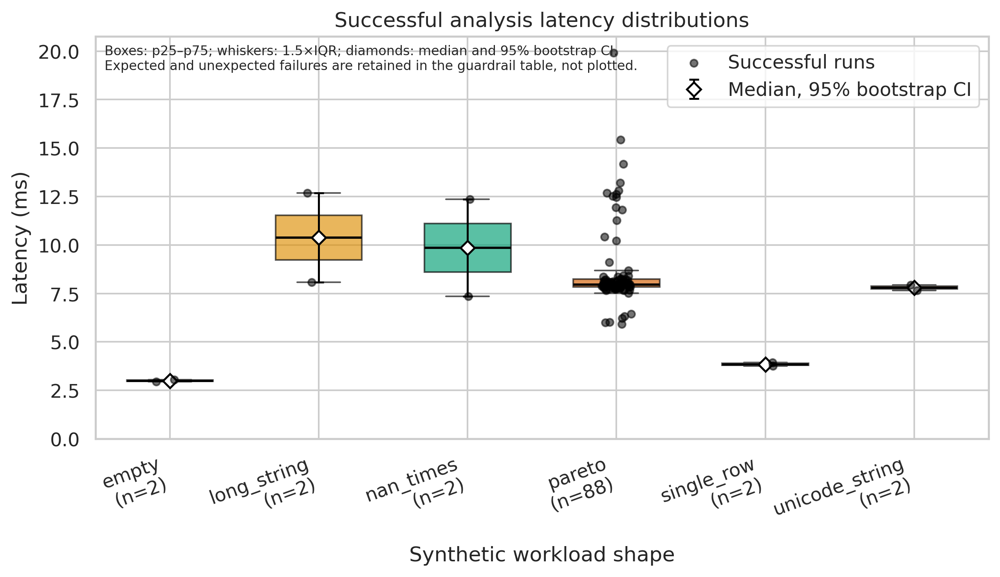

# 4. Experimental Results & Discussion

> **Demonstration only:** all values in this section come from synthetic repository
> fixtures. They validate the analysis workflow and are not empirical findings about
> real organizations or production ITSM systems.

## 4.1 Research-group comparison

The Task 2 sample contains four legacy cases (C1) and four guardrailed-hybrid cases
(E1). Values are medians with the interquartile range (p25–p75). Handoff reduction
uses paired legacy and AI times, which are absent from C1; no baseline value is
imputed.

| Metric | Baseline: C1 (n=4) | Proposed: E1 (n=4) |
|---|---:|---:|
| HITL embedding score (1–5) | 1.50 (1.00–2.00) | 4.00 (4.00–4.25) |
| Handoff reduction (%) | Not available | 53.59 (51.64–54.81) |
| Misrouting rate (%) | 15.83 (14.89–17.00) | 5.78 (5.48–6.17) |
| Governance index (0–3) | 1.50 (0.75–2.00) | 3.00 (2.75–3.00) |

These descriptive differences should not be read as support for H1.1–H1.3: the
observations are synthetic and the group sizes are too small for research
conclusions.

## 4.2 Analysis-pipeline benchmark

The benchmark ran one synchronous analysis call per evaluation record on synthetic
inputs. Of 100 evaluation runs, 98 succeeded and two deliberately invalid-input
edge cases raised their expected validation error. The total evaluation error rate
is therefore 2%; the unexpected-error rate is 0%. Warm-up observations are excluded
from latency aggregation. Errors are counted in the guardrail instead of being
silently discarded.

| Metric | Synthetic local profile |
|---|---:|
| Successful evaluation runs | 98 / 100 |
| Total error rate | 2.00% (2 expected invalid-input errors) |
| Unexpected error rate | 0.00% (guardrail threshold: 0.00%) |
| Latency median (p25–p75) | 7.32 ms (6.10–10.42 ms) |
| Latency p95 | 34.59 ms |
| Latency p99 | 36.43 ms |

The p99 is indicative because it is estimated from fewer than 1,000 successful
runs. Bootstrap intervals, workload-size summaries, all run records, and captured
environment metadata are available in the repository outputs.

## 4.3 Scientific figures



**Figure 1.** The median, p95, and p99 latency of the analysis call across synthetic
input-size bins (cases per call). Shaded bands represent 95% percentile-bootstrap
confidence intervals. The increasing input sizes show the workload dimension
measured by this harness; this experiment does not control an offered request rate
and therefore does not report RPS.



**Figure 2.** Successful-run latency distributions by synthetic workload shape.
Boxes show p25–p75, whiskers extend to 1.5×IQR, and black diamonds show the median
with its 95% bootstrap confidence interval. Expected and unexpected failed runs are
retained in the separate error-rate guardrail and are not shown as successful
latency observations.

Both figures are exported as vector PDF and 300-DPI PNG under `reports/figures/`.
The plotting code uses a colorblind-safe palette and distinct markers/line styles.

## 4.4 Discussion and limitations

This run demonstrates end-to-end ingestion, warm-up exclusion, error accounting,
non-destructive outlier flags, seeded bootstrap intervals, and figure export. It
does **not** evaluate an ITSM service, request throughput, concurrency, or network
latency. Nor does it compare two measured runtime implementations. Thus, the runtime
profile cannot support a legacy-versus-proposed latency claim. That comparison
requires representative de-identified study inputs, a controlled request-rate
schedule, a measured baseline implementation, and a predeclared protocol.

The C1/E1 values are included to fulfill the research-group comparison format, but
remain synthetic test data. Once real cases are collected and double-coded, rerun
the benchmark and notebook before replacing this warning or interpreting the
research metrics.

## 4.5 Reproduction

From the repository root, install the pinned Python dependencies and run:

```bash
python run_pipeline.py --config configs/config.yaml
```

The notebook `notebooks/01_data_analysis.ipynb` reproduces the tabular summaries
and figures from the checked-in JSONL log using seed 42 and 2,000 bootstrap
resamples.
